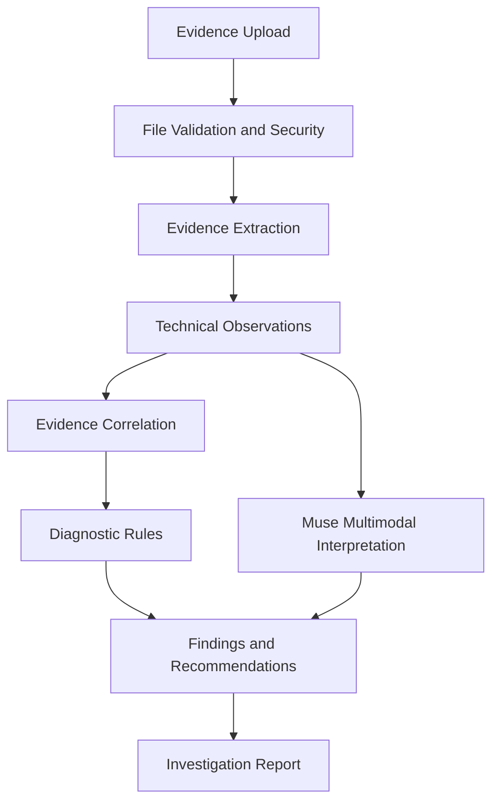

# DeploySift

**Every clue. One diagnosis.**

DeploySift is an evidence-first AI investigation platform that helps developers diagnose deployment failures by correlating project configuration, application logs, browser errors, and hosting-environment evidence. It transforms scattered technical clues into traceable observations, evidence-backed findings, remediation recommendations, and verification checklists.

    

Built for the Meta Global AI Developer Hackathon 2026.

## The problem

Deployment failures are hard to diagnose because the relevant information is scattered across project configuration, Composer dependencies, application logs, browser network errors, hosting control panels, and runtime configuration. Without SSH access — common on shared hosting, Plesk, and managed platforms — developers are left guessing which layer broke.

DeploySift brings these evidence sources together in one investigation: upload what you have, get deterministic parsing and cross-source correlation immediately, and optional Meta Muse reasoning on top — every conclusion linked back to the evidence that supports it.

## Key capabilities

- Multi-source evidence upload (project files, logs, hosting panels/screenshots, browser exports, ZIP archives)
- Technical evidence extraction with per-file facts (PHP constraints, Laravel version, log exceptions, HTTP statuses, handler, extensions)
- Laravel/PHP deployment diagnostics (10 deterministic rule families)
- Browser error interpretation and hosting configuration interpretation
- Evidence correlation across sources with supporting-evidence links
- Root-cause assessment (`established` vs `not_established` — never forced)
- Evidence-linked findings with severity, expected vs observed, and triggering rule
- Missing-information detection and potential-issue analysis for partial evidence
- Remediation recommendations and verification checklists per finding
- Investigation report generation with JSON export and browser print/PDF
- Workspace-scoped authentication with owner/member/viewer policies
- Honest AI status: `configured` / `not_configured` / `skipped` / `invalid` / `failed` — never fabricated

## Meta Muse integration

Meta Muse (`muse-wonder-1.0` via `POST /v1/responses`) contributes **interpretation only** — it never replaces deterministic diagnosis:

| Layer | Source | Role |
|---|---|---|
| Deterministic diagnostics | `DiagnosticEngine` rules | Confirmed findings with evidence IDs, severity, expected/observed |
| Muse-generated interpretations | Responses API, strict-JSON contract | Hypotheses and cross-source explanations, each required to cite real evidence IDs |
| Evidence correlation | Deterministic relationships | Which evidence supports which finding |
| Final findings | Deterministic + validated AI | Only validated output is shown; anything ungrounded is rejected |

What the adapter sends: a redacted evidence package (facts + finding titles, never raw secrets), plus up to 3 screenshots as base64 `input_image` parts. What it enforces on return: valid JSON, a fixed confidence scale (`verified observation`, `strongly supported inference`, `possible explanation`, `missing information`, `contradictory evidence`), and evidence IDs that must match stored evidence — otherwise the run is recorded as `invalid` and discarded. Timeouts (60 s), retries, and token usage are recorded per run in `ai_analysis_runs` with `store: false`.

If no credentials are configured, analysis is skipped honestly (`not_configured`) and the deterministic pipeline carries the full report — no AI result is ever invented. SAM 3.1 and Muse Voice Transcribe are **not** integrated.

## How DeploySift works



Upload (`POST /api/.../upload`, 10 MB cap, extension allowlist, ZIP traversal/executable caps, secret redaction, UTF-8 normalization, SHA-256 dedup, private storage) → deterministic extraction into per-evidence facts → observations, potential issues, and missing-evidence hints derived from those facts → optional Muse interpretation validated against evidence IDs → correlation links findings to evidence → reports with recommendations, verification steps, and export.

## Demonstration scenario

Synthetic PHP-version incompatibility, processed end-to-end (seeded via `php artisan db:seed`, or POST `/api/demo/php`):

| Evidence | Observation |
|---|---|
| `composer.json` | Requires PHP `^8.3` |
| `laravel.log` | Runtime reports PHP 8.1.27 (`platform_check.php`) |
| `network.txt` | Login request returns HTTP 500 |
| `hosting-panel.txt` | Hosting configured for PHP 8.1.27 |

Expected diagnosis: **the hosting PHP runtime is incompatible with the project's declared PHP requirement** — connected across all four sources with evidence IDs on every link. Note what DeploySift does *not* do: a lone `composer.json` yields observations and a *potential* hosting risk, but explicitly states the runtime is unverified — no mismatch is claimed without hosting evidence.

The exact files above ship in [`samples/`](samples/) with upload instructions in [`samples/README.md`](samples/README.md) — upload them through the browser UI or the evidence API to reproduce this diagnosis on any local instance.

## Screenshots and demo video

Genuine application screenshots captured headless against the running app:

- [Dashboard](demo/screenshots/dashboard.png) — live metrics and recent investigations
- [Investigation](demo/screenshots/investigation.png) — findings with linked evidence
- [Evidence explorer](demo/screenshots/evidence.png) — upload queue and evidence list
- [AI analysis](demo/screenshots/ai-analysis.png) — overview, observations, interpretation
- [Report](demo/screenshots/report.png) — sections, recommendations, verification checklist

Demo video: not yet recorded. Suggested 90-second script — (1) launch the PHP 8.3 vs 8.1 demo, (2) drag in one more log file, (3) run AI analysis and open an evidence link, (4) open the report and download JSON. Record at 1080p against a seeded local instance.

## Technology stack

Verified in this repository (see `composer.json`, `package.json`, `config/`, `database/migrations/`):

| Technology | Version / role |
|---|---|
| PHP | ^8.3 (developed and verified on 8.3.28) |
| Laravel | ^13.17 REST API, Blade views, Eloquent, database queue |
| MySQL | 8.x primary store (SQLite in-memory for tests) |
| Frontend | Server-rendered Blade + vanilla JavaScript + hand-written CSS (dark SaaS theme); no framework build step required |
| Vite 8 + Tailwind CSS 4 | Present in `devDependencies`; the UI does not depend on compiled assets |
| PHPUnit 12 | 54 tests, 297 assertions (`php artisan test`) |
| Playwright 1.64 | 9 end-to-end browser tests (`npm run test:e2e`), incl. a live Muse call |
| Meta Muse API | `muse-wonder-1.0` via the Responses API (`App\Services\MuseAdapter`) |
| Composer 2 / Node 18+ / npm | Dependency management and e2e/build tooling |

## System requirements

- PHP 8.3 with extensions: `pdo_mysql`, `mbstring`, `openssl`, `curl`, `fileinfo`, `zip`, `sodium` (verify: `php -m`)
- Composer 2.x and Node.js 18+ with npm (npm only needed for e2e tests and the optional asset build)
- MySQL 8.x with a dedicated database and user
- Writable `storage/` and `bootstrap/cache/` directories
- A queue worker (`php artisan queue:work`) for asynchronous diagnostics; without one, `process` requests stay `pending` until a worker runs
- Outbound HTTPS for Meta Muse calls (optional — deterministic diagnostics work fully offline)

## Installation and setup

```powershell
git clone <your-fork-url> deploysift
cd deploysift
composer install
Copy-Item .env.example .env   # Windows; or: cp .env.example .env
php artisan key:generate
```

Edit `.env`: set `DB_DATABASE`, `DB_USERNAME`, `DB_PASSWORD` (default database name is `stackora`), then:

```powershell
php artisan migrate --force   # use migrate:fresh --seed only to reset demo data
php artisan db:seed           # loads the three synthetic demo scenarios
npm install                   # only needed for e2e tests
```

Optional: set `MUSE_API_KEY`, `MUSE_API_ENDPOINT` (`https://api.meta.ai`), `MUSE_MODEL=muse-wonder-1.0` to enable AI analysis. Optional: `GOOGLE_*` / `GITHUB_*` for OAuth login.

On Windows with WAMP, either add `C:\wamp64\bin\php\php8.3.28` to `PATH` or substitute that full path for `php` in every command below.

## Environment configuration

| Variable | Purpose | Required |
|---|---|---|
| `APP_NAME` | Product name shown in UI and mail | Yes (default `DeploySift`) |
| `APP_KEY` | Encryption key (`php artisan key:generate`) | Yes |
| `APP_URL` | Public base URL | Yes for production |
| `DB_CONNECTION`, `DB_HOST`, `DB_PORT`, `DB_DATABASE`, `DB_USERNAME`, `DB_PASSWORD` | MySQL connection | Yes |
| `SESSION_DRIVER` / `CACHE_STORE` / `QUEUE_CONNECTION` | `database` recommended (file/array for local experiments) | Yes |
| `MUSE_API_KEY`, `MUSE_API_ENDPOINT`, `MUSE_MODEL` | Meta Muse credentials, endpoint, model id | Only for AI analysis |
| `GOOGLE_CLIENT_ID/SECRET/REDIRECT_URI`, `GITHUB_*` | OAuth login providers | Only for OAuth |
| `MAIL_*` | Mail transport (defaults to `log`) | Only for real mail |
| `FILESYSTEM_DISK` | Must remain `local` — evidence must never be served publicly | Yes |

Never commit real keys, tokens, or passwords. `.env` is gitignored; only `.env.example` (empty values) is committed.

## Running the application

```powershell
php artisan serve                 # http://127.0.0.1:8000
php artisan queue:work --tries=3  # required for async diagnostics; otherwise process stays pending
php artisan route:list --path=api # 17 API routes
php artisan test                  # full PHPUnit suite
npm run test:e2e                  # Playwright suite (starts its own server; one test uses live Muse)
npm run build                     # optional asset build (UI needs no compiled assets to run)
```

## Running tests

```powershell
php artisan test                  # 54 tests, 297 assertions (SQLite, no external services)
php artisan test --filter=UploadRulesTest
npm run test:e2e                  # 9 browser tests incl. one live Muse analysis (~60 s, uses MUSE_* creds)
```

The e2e suite boots its own server, registers users, runs the full demo workflow, uploads files, and verifies the live AI response shape — never its specific wording.

## Security and limitations

Implemented and tested:

- Workspace-scoped authorization on every investigation, evidence, upload, processing, AI, and report endpoint (cross-user access returns 403/404).
- Session authentication with CSRF protection; login/registration throttled (10/min); authenticated API throttled (60/min).
- Private evidence storage (`storage/app/private`, never linked or served); ZIP path-traversal and executable rejection; 50-file / 5 MB extraction caps; 10 MB upload limit with extension allowlist.
- Secrets redacted before storage and before any AI call; uploaded code is parsed as text, never executed.
- AI output validated against stored evidence IDs; ungrounded responses rejected and logged; `store: false` on Muse calls; redacted inputs persisted for audit.
- No known exposed secrets: `.env` is gitignored and the repo contains no real keys.

Limitations (no production security audit has been performed):

- Hosting screenshots are interpreted by Meta Muse when configured; without it the app records a placeholder and makes no claims about unseen values.
- Document-root detection trusts hosting-panel text as observed, not verified.
- Contradiction handling reports conflicts explicitly; it is not automated refutation.
- SAM 3.1 segmentation and voice transcription are not integrated.
- Anonymous API flood is answered with cheap 401s; per-user throttling applies after authentication.

## Project roadmap

Implemented: end-to-end investigation workflow, 10 deterministic rule families, evidence correlation, AI integration with validation, auth + workspace isolation, upload UI with ZIP safety, dashboard metrics, reporting with export/print, full test coverage, production runbook.

In progress: nothing — the current milestone is complete and green.

Planned (not started): SAM 3.1 screenshot segmentation evaluation, Muse voice transcription for incident intake, user notifications, user profile management.

## License and acknowledgements

No LICENSE file is present in this repository — all rights are reserved by default. Add an explicit open-source license before public release if open distribution is intended.

Built with [Laravel](https://laravel.com), tested with [PHPUnit](https://phpunit.de) and [Playwright](https://playwright.dev). AI analysis by the [Meta Muse API](https://dev.meta.ai) (`muse-wonder-1.0`). See [SUBMISSION.md](SUBMISSION.md) for the hackathon summary and [docs/DEPLOYMENT.md](docs/DEPLOYMENT.md) for production deployment.
